# PRAKTIKUM 6 JavaScript DOM dan Event Handling

| Keterangan | Informasi |
|---|---|
| Nama | Bagas Arya Ramadhan |
| Nim | 312510328|
| Kelas | I251D |
| Universitas | Universitas Pelita Bangsa |
| Mata Kuliah  | Pemrograman Web |
| Materi  | JavaScript DOM dan Event Handling |

---

##Pelaksanaan Latihan

### Latihan 1  Mengakses dan Mengubah Elemen DOM

**Tujuan:**

Memahami cara mengambil elemen HTML menggunakan `document.getElementById()` dan mengubah isi teks menggunakan `textContent`.

**Langkah pengerjaan:**

1. Buka file `index.html`.
2. Pastikan terdapat elemen dengan ID `judul` dan `pesan`.
3. Buka file `script.js`.
4. Tambahkan kode JavaScript berikut:

```javascript
const judul = document.getElementById("judul");
const pesan = document.getElementById("pesan");

judul.textContent = "Belajar JavaScript DOM";
pesan.textContent = "Konten berhasil diubah oleh JavaScript.";
```


**Penjelasan kode:**

- `document.getElementById("judul")` digunakan untuk mengambil elemen HTML yang memiliki ID `judul`.
- `document.getElementById("pesan")` digunakan untuk mengambil elemen HTML dengan ID `pesan`.
- `textContent` digunakan untuk mengganti teks yang terdapat di dalam elemen HTML.

**Hasil yang diharapkan:**

Teks judul berubah menjadi "Belajar JavaScript DOM", sedangkan isi paragraf berubah menjadi "Konten berhasil diubah oleh JavaScript."


---

### Latihan 2  Event Handling Menggunakan addEventListener()

**Tujuan:**

Memahami cara menangani event klik pada tombol menggunakan `addEventListener()`.

**Langkah pengerjaan:**

1. Pastikan terdapat tombol dengan ID `tombolAksi`.
2. Ambil elemen tombol dan paragraf menggunakan JavaScript.
3. Tambahkan event listener dengan jenis event `click`.

Contoh kode:

```javascript
const tombol = document.getElementById("tombolAksi");
const pesan = document.getElementById("pesan");

tombol.addEventListener("click", function () {
  pesan.textContent = "Tombol diklik pada " + new Date().toLocaleTimeString();
});
```


**Penjelasan kode:**

- `getElementById()` digunakan untuk mengambil elemen tombol dan paragraf.
- `addEventListener("click", ...)` digunakan untuk mendeteksi ketika tombol diklik.
- `new Date()` digunakan untuk mendapatkan waktu saat ini.
- `toLocaleTimeString()` digunakan untuk menampilkan waktu dalam format lokal.
- `textContent` digunakan untuk menampilkan waktu klik pada paragraf.

**Hasil yang diharapkan:**

Ketika tombol diklik, paragraf menampilkan waktu saat tombol tersebut ditekan. Jika tombol diklik kembali, waktu akan diperbarui.

**Pengujian:**

Klik tombol beberapa kali dan perhatikan perubahan waktu yang ditampilkan.

---

### Latihan 3 Manipulasi Class CSS Menggunakan classList

**Tujuan:**

Memahami cara menambahkan, menghapus, dan mengubah class CSS pada elemen HTML menggunakan JavaScript.

**Langkah pengerjaan:**

1. Tambahkan aturan CSS pada file `style.css`.
2. Buat paragraf dengan ID `teksGaya`.
3. Buat tombol dengan ID `tombolGaya`.
4. Tambahkan kode JavaScript berikut:

**Kode CSS:**

```css
.highlight {
  color: #173f75;
  background-color: #e6f1ff;
  border-left: 4px solid #3478c8;
  padding: 12px;
}

.teks-besar {
  font-size: 1.4rem;
}
```

**Kode JavaScript:**

```javascript
const tombolGaya = document.getElementById("tombolGaya");
const teksGaya = document.getElementById("teksGaya");

tombolGaya.addEventListener("click", function () {
  teksGaya.classList.toggle("highlight");
  teksGaya.classList.toggle("teks-besar");
});
```

**Penjelasan kode:**

- `.highlight` memberikan warna teks, warna latar belakang, garis tepi kiri, dan padding.
- `.teks-besar` digunakan untuk memperbesar ukuran tulisan.
- `classList.toggle()` digunakan untuk menambahkan class jika belum ada atau menghapusnya jika sudah ada.
- Ketika tombol diklik, kedua class CSS akan berganti secara bersamaan.

**Hasil yang diharapkan:**

Paragraf akan berubah tampilan ketika tombol diklik. Jika tombol diklik kembali, tampilan akan kembali seperti semula.

**Pengujian:**

Klik tombol beberapa kali dan amati perubahan tampilan paragraf.

---

### Latihan 4 — Menghitung Jumlah Karakter Input

**Tujuan:**

Memahami penggunaan event `input` untuk mendeteksi perubahan nilai pada kolom input secara langsung.

**Langkah pengerjaan:**

1. Tambahkan label dan input dengan ID `namaInput`.
2. Tambahkan elemen untuk menampilkan jumlah karakter dengan ID `jumlahKarakter`.
3. Tambahkan kode JavaScript berikut:

**Kode HTML:**

```html
<label for="namaInput">Nama:</label>
<input type="text" id="namaInput" maxlength="40">

<p>Jumlah karakter: <span id="jumlahKarakter">0</span></p>
```

**Kode JavaScript:**

```javascript
const namaInput = document.getElementById("namaInput");
const jumlahKarakter = document.getElementById("jumlahKarakter");

namaInput.addEventListener("input", function () {
  jumlahKarakter.textContent = namaInput.value.length;
});
```

**Penjelasan kode:**

- `input` digunakan untuk mendeteksi perubahan pada kolom input.
- `namaInput.value` mengambil nilai teks yang dimasukkan pengguna.
- `.length` menghitung jumlah karakter.
- `textContent` menampilkan hasil perhitungan pada halaman web.
- `maxlength="40"` membatasi jumlah karakter yang dapat dimasukkan menjadi maksimal 40 karakter.

**Hasil yang diharapkan:**

Jumlah karakter akan bertambah atau berkurang secara otomatis sesuai dengan isi kolom input.

**Pengujian:**

1. Masukkan beberapa karakter.
2. Perhatikan jumlah karakter yang muncul.
3. Hapus beberapa karakter.
4. Tempelkan teks menggunakan fitur paste.
5. Amati perubahan jumlah karakter.

---

### Latihan 5  Validasi Form Pendaftaran

**Tujuan:**

Memahami cara membuat validasi form menggunakan JavaScript sebelum data diproses.

**Langkah pengerjaan:**

1. Buat form pendaftaran dengan input nama, email, dan usia.
2. Tambahkan tombol submit.
3. Tambahkan paragraf untuk menampilkan pesan validasi.
4. Tambahkan kode JavaScript berikut:

**Kode HTML:**

```html
<form id="formPendaftaran" novalidate>
  <label for="nama">Nama lengkap</label>
  <input id="nama" name="nama" type="text">

  <label for="email">Email</label>
  <input id="email" name="email" type="email">

  <label for="usia">Usia</label>
  <input id="usia" name="usia" type="number" min="17" max="100">

  <button type="submit">Daftar</button>
</form>

<p id="pesanForm" aria-live="polite"></p>
```

**Kode JavaScript:**

```javascript
const form = document.getElementById("formPendaftaran");
const pesanForm = document.getElementById("pesanForm");

form.addEventListener("submit", function (event) {
  event.preventDefault();

  const nama = document.getElementById("nama").value.trim();
  const email = document.getElementById("email").value.trim();
  const usiaInput = document.getElementById("usia").value;
  const usia = Number(usiaInput);
  const polaEmail = /^[^\s@]+@[^\s@]+\.[^\s@]+$/;

  if (nama === "") {
    pesanForm.textContent = "Nama wajib diisi.";
  } else if (!polaEmail.test(email)) {
    pesanForm.textContent = "Masukkan email yang valid.";
  } else if (usiaInput === "" || !Number.isInteger(usia) || usia < 17 || usia > 100) {
    pesanForm.textContent = "Usia harus berupa bilangan bulat 17–100.";
  } else {
    pesanForm.textContent = "Validasi berhasil. Form siap diproses.";
    form.reset();
  }
});
```

**Penjelasan kode:**

- `addEventListener("submit", ...)` digunakan untuk menangani pengiriman form.
- `event.preventDefault()` mencegah form dikirim dengan perilaku bawaan browser.
- `.value` digunakan untuk mengambil nilai input.
- `.trim()` menghapus spasi di awal dan akhir teks.
- `Number()` mengubah nilai usia menjadi angka.
- `Number.isInteger()` memeriksa apakah usia merupakan bilangan bulat.
- Regex `polaEmail` digunakan untuk memeriksa format email.
- Percabangan `if` dan `else if` digunakan untuk menentukan pesan validasi.
- `form.reset()` mengosongkan kembali input setelah validasi berhasil.

**Hasil yang diharapkan:**

Form dapat memeriksa kelengkapan nama, format email, serta usia sebelum menampilkan pesan keberhasilan.

**Pengujian:**

Lakukan minimal lima pengujian berikut:

1. Semua kolom dikosongkan. Hasil: "Nama wajib diisi."
2. Nama dikosongkan, tetapi kolom lain diisi. Hasil: "Nama wajib diisi."
3. Email menggunakan format tidak valid. Hasil: "Masukkan email yang valid."
4. Usia kurang dari 17 tahun. Hasil: "Usia harus berupa bilangan bulat 17–100."
5. Nama, email, dan usia diisi dengan benar. Hasil: "Validasi berhasil. Form siap diproses."

---

### Latihan 6  Membuat To-do List Dinamis

**Tujuan:**

Memahami cara membuat elemen HTML secara dinamis menggunakan JavaScript dan menangani event pada elemen yang dibuat.

**Langkah pengerjaan:**

1. Buat input untuk memasukkan tugas baru.
2. Buat tombol untuk menambahkan tugas.
3. Buat elemen `<ul>` untuk menampilkan daftar tugas.
4. Tambahkan kode JavaScript berikut:

**Kode HTML:**

```html
<section>
  <h2>Daftar Tugas</h2>

  <label for="inputTugas">Tugas baru</label>
  <input id="inputTugas" type="text">

  <button id="tambahTugas" type="button">Tambah</button>

  <p id="pesanTugas" aria-live="polite"></p>

  <ul id="daftarTugas"></ul>
</section>
```

**Kode JavaScript:**

```javascript
const inputTugas = document.getElementById("inputTugas");
const tambahTugas = document.getElementById("tambahTugas");
const daftarTugas = document.getElementById("daftarTugas");
const pesanTugas = document.getElementById("pesanTugas");

tambahTugas.addEventListener("click", function () {
  const teks = inputTugas.value.trim();

  if (teks === "") {
    pesanTugas.textContent = "Tulis tugas terlebih dahulu.";
    return;
  }

  const item = document.createElement("li");
  const label = document.createElement("span");
  const selesai = document.createElement("button");

  label.textContent = teks + " ";
  selesai.type = "button";
  selesai.textContent = "Tandai selesai";

  selesai.addEventListener("click", function () {
    item.classList.toggle("selesai");

    selesai.textContent = item.classList.contains("selesai")
      ? "Batalkan selesai" : "Tandai selesai";
  });

  item.append(label, selesai);
  daftarTugas.appendChild(item);

  inputTugas.value = "";
  pesanTugas.textContent = "Tugas ditambahkan.";
  inputTugas.focus();
});
```

**Kode CSS:**

```css
.selesai span {
  text-decoration: line-through;
  color: #687386;
}

li {
  margin-bottom: 8px;
}
```

**Penjelasan kode:**

- `document.createElement()` digunakan untuk membuat elemen HTML baru.
- `createElement("li")` membuat elemen daftar tugas.
- `createElement("span")` membuat elemen untuk menampilkan teks tugas.
- `createElement("button")` membuat tombol untuk menandai tugas selesai.
- `append()` memasukkan beberapa elemen ke dalam elemen induk.
- `appendChild()` menambahkan item tugas ke dalam daftar.
- `classList.toggle()` mengubah status penyelesaian tugas.
- `classList.contains()` memeriksa apakah sebuah class sudah dimiliki elemen.
- `inputTugas.value = ""` mengosongkan kolom input setelah tugas ditambahkan.
- `inputTugas.focus()` mengembalikan fokus ke kolom input.

**Hasil yang diharapkan:**

Pengguna dapat menambahkan tugas baru, melihat daftar tugas, serta menandai tugas sebagai selesai atau membatalkan status selesai.

**Pengujian:**

1. Klik tombol Tambah tanpa mengisi input.
2. Masukkan nama tugas dan klik Tambah.
3. Pastikan tugas muncul dalam daftar.
4. Klik tombol Tandai selesai.
5. Klik kembali untuk membatalkan status selesai.

---

## 5. Mini Project  Form Pendaftaran Workshop

### 5.1 Tujuan Mini Project

Mini Project dibuat untuk menggabungkan materi DOM dan Event Handling yang telah dipelajari sebelumnya ke dalam sebuah aplikasi sederhana berupa form pendaftaran workshop.

Berdasarkan instruksi modul, Mini Project harus memiliki fitur:

1. Validasi nama, email, dan pilihan sesi.
2. Penghitung karakter atau ringkasan input secara langsung.
3. Pesan error dan keberhasilan yang ditampilkan pada halaman.
4. Tombol reset atau hapus input.
5. Penggunaan `addEventListener()` untuk event input, change, click, dan submit.
6. Tampilan yang mudah digunakan pada desktop maupun perangkat mobile.

**Catatan:** Modul memberikan ketentuan fitur Mini Project, bukan kode implementasi lengkap. Oleh karena itu, kode yang dibuat merupakan implementasi untuk memenuhi ketentuan tersebut.

### 5.2 Struktur Form

Form pendaftaran memiliki beberapa komponen utama:

- Input nama lengkap.
- Input alamat email.
- Dropdown pilihan sesi workshop.
- Penghitung jumlah karakter nama.
- Area pesan validasi.
- Tombol Daftar.
- Tombol Reset.

### 5.3 Implementasi JavaScript

Kode JavaScript Mini Project:

```javascript
const formWorkshop = document.getElementById("formWorkshop");
const namaWorkshop = document.getElementById("namaWorkshop");
const emailWorkshop = document.getElementById("emailWorkshop");
const sesiWorkshop = document.getElementById("sesiWorkshop");
const jumlahWorkshop = document.getElementById("jumlahWorkshop");
const pesanWorkshop = document.getElementById("pesanWorkshop");

namaWorkshop.addEventListener("input", function () {
  jumlahWorkshop.textContent = namaWorkshop.value.length;
});

sesiWorkshop.addEventListener("change", function () {
  pesanWorkshop.textContent = "Sesi dipilih: " + sesiWorkshop.value;
});

formWorkshop.addEventListener("submit", function (event) {
  event.preventDefault();

  const nama = namaWorkshop.value.trim();
  const email = emailWorkshop.value.trim();
  const sesi = sesiWorkshop.value;
  const polaEmail = /^[^\s@]+@[^\s@]+\.[^\s@]+$/;

  if (nama === "") {
    pesanWorkshop.textContent = "Nama wajib diisi.";
  } else if (!polaEmail.test(email)) {
    pesanWorkshop.textContent = "Masukkan email yang valid.";
  } else if (sesi === "") {
    pesanWorkshop.textContent = "Silakan pilih sesi workshop.";
  } else {
    pesanWorkshop.textContent = "Pendaftaran workshop berhasil.";
  }
});

formWorkshop.addEventListener("reset", function () {
  jumlahWorkshop.textContent = "0";
  pesanWorkshop.textContent = "";
});
```

### 5.4 Penjelasan Fitur

**A. Penghitung Karakter**

Event `input` digunakan untuk mendeteksi perubahan teks pada kolom nama. Jumlah karakter ditampilkan secara langsung menggunakan `.length`.

**B. Pilihan Sesi Workshop**

Event `change` digunakan untuk mendeteksi perubahan pilihan pada dropdown. Ketika pengguna memilih sesi, halaman menampilkan sesi yang dipilih.

**C. Validasi Form**

Event `submit` digunakan untuk memeriksa data sebelum pendaftaran dinyatakan berhasil. Validasi meliputi nama, format email, dan pilihan sesi.

**D. Pesan Validasi**

Pesan error maupun keberhasilan ditampilkan menggunakan `textContent` pada elemen `pesanWorkshop`.

**E. Tombol Reset**

Event `reset` digunakan untuk mengembalikan jumlah karakter menjadi nol dan menghapus pesan yang ditampilkan.

### 5.5 Hasil yang Diharapkan

Mini Project dapat menjalankan proses validasi form pendaftaran workshop, menghitung karakter nama, menampilkan sesi yang dipilih, serta memberikan pesan kepada pengguna sesuai kondisi input.

---

## 6. Eksperimen Mandiri

### Eksperimen 1  Menambahkan Tombol Hapus pada To-do List

**Tujuan:**

Menambahkan fitur untuk menghapus satu item tugas dari daftar To-do List.

**Implementasi:**

Buat tombol hapus menggunakan `document.createElement()` di dalam event penambahan tugas.

```javascript
const hapus = document.createElement("button");

hapus.type = "button";
hapus.textContent = "Hapus";

hapus.addEventListener("click", function () {
  item.remove();
});
```

Kemudian gabungkan tombol tersebut dengan elemen tugas:

```javascript
item.append(label, selesai, hapus);
```

**Penjelasan:**

- `createElement("button")` membuat tombol baru.
- `textContent` memberikan tulisan Hapus.
- `addEventListener("click", ...)` menangani klik tombol.
- `item.remove()` menghapus item tugas dari daftar.

**Hasil yang diharapkan:**

Setiap tugas memiliki tombol Hapus yang dapat digunakan untuk menghapus tugas tersebut secara individual.

---

### Eksperimen 2 Mengubah Validasi Nama Minimal Tiga Karakter

**Tujuan:**

Mengubah validasi nama pada form agar nama harus memiliki minimal tiga karakter.

**Implementasi:**

Pada bagian validasi nama di Latihan 5, ubah kondisi:

```javascript
if (nama === "") {
  pesanForm.textContent = "Nama wajib diisi.";
}
```

Menjadi:

```javascript
if (nama.length < 3) {
  pesanForm.textContent = "Nama minimal terdiri dari tiga karakter.";
}
```

**Penjelasan:**

- `nama.length` digunakan untuk menghitung jumlah karakter nama.
- Kondisi `< 3` memeriksa apakah jumlah karakter kurang dari tiga.
- Jika kurang dari tiga karakter, pesan validasi akan ditampilkan.

**Pengujian:**

| Input Nama | Hasil |
|---|---|
| Kosong | Validasi gagal |
| A | Validasi gagal |
| AB | Validasi gagal |
| ABC | Lolos validasi nama |
| Bagas | Lolos validasi nama |

Untuk mendapatkan hasil validasi keseluruhan yang berhasil, email juga harus valid dan usia harus berada pada rentang 17–100 tahun.

---

### Eksperimen 3  Event Change pada Dropdown Workshop

**Tujuan:**

Menampilkan pilihan sesi workshop yang dipilih oleh pengguna.

**Implementasi:**

Pada Mini Project, fitur ini sudah dibuat menggunakan kode:

```javascript
sesiWorkshop.addEventListener("change", function () {
  pesanWorkshop.textContent = "Sesi dipilih: " + sesiWorkshop.value;
});
```

**Penjelasan:**

- `addEventListener("change", ...)` mendeteksi perubahan pilihan dropdown.
- `sesiWorkshop.value` mengambil nilai sesi yang dipilih.
- `textContent` menampilkan pilihan tersebut pada halaman.

**Pengujian:**

1. Pilih Sesi 1.
2. Periksa pesan yang muncul.
3. Pilih Sesi 2.
4. Periksa perubahan pesan.

**Hasil yang diharapkan:**

Halaman menampilkan sesi yang dipilih, misalnya "Sesi dipilih: Sesi 1".

---

### Eksperimen 4 Menyembunyikan dan Menampilkan Paragraf

**Tujuan:**

Membuat tombol yang dapat menyembunyikan dan menampilkan paragraf menggunakan class CSS.

**Implementasi HTML:**

```html
<p id="paragrafToggle">
  Paragraf ini bisa disembunyikan dan ditampilkan.
</p>

<button id="tombolToggle" type="button">
  Sembunyikan/Tampilkan
</button>
```

**Implementasi CSS:**

```css
.tersembunyi {
  display: none;
}
```

**Implementasi JavaScript:**

```javascript
const tombolToggle = document.getElementById("tombolToggle");
const paragrafToggle = document.getElementById("paragrafToggle");

tombolToggle.addEventListener("click", function () {
  paragrafToggle.classList.toggle("tersembunyi");
});
```

**Penjelasan:**

- Class `.tersembunyi` menggunakan `display: none` untuk menyembunyikan paragraf.
- `getElementById()` mengambil tombol dan paragraf.
- `addEventListener("click", ...)` mendeteksi klik tombol.
- `classList.toggle()` menambahkan atau menghapus class CSS secara bergantian.

**Hasil yang diharapkan:**

Paragraf akan menghilang ketika tombol diklik dan muncul kembali ketika tombol diklik sekali lagi.

---

### Eksperimen 5  Memindahkan Script Tanpa Atribut defer

**Tujuan:**

Mengamati perbedaan perilaku JavaScript ketika dipanggil di bagian `<head>` menggunakan atribut `defer` dan tanpa atribut `defer`.

**Langkah pengerjaan:**

1. Buka file `index.html`.
2. Cari pemanggilan file JavaScript:

```html
<script src="script.js" defer></script>
```

3. Hapus atribut `defer` sehingga menjadi:

```html
<script src="script.js"></script>
```

4. Simpan perubahan.
5. Refresh halaman pada browser.
6. Amati hasilnya melalui tampilan halaman dan Console.

**Penjelasan:**

Ketika script dipanggil di bagian `<head>` tanpa atribut `defer`, browser akan menjalankan JavaScript sebelum melanjutkan parsing bagian HTML berikutnya.

Akibatnya, JavaScript dapat mencoba mengambil elemen HTML yang belum tersedia. Jika elemen belum ditemukan, hasil `getElementById()` dapat berupa `null` dan menyebabkan error ketika properti elemen digunakan.

Atribut `defer` membuat browser menjalankan script setelah dokumen HTML selesai diparsing.

**Kesimpulan:**

Penggunaan `defer` membantu memastikan elemen HTML telah diparsing sebelum JavaScript dijalankan. Setelah pengujian, pemanggilan script dikembalikan seperti semula:

```html
<script src="script.js" defer></script>
```

### Screenshoot Hasil 


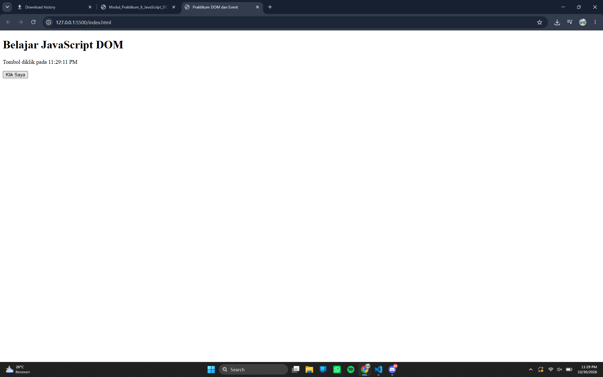
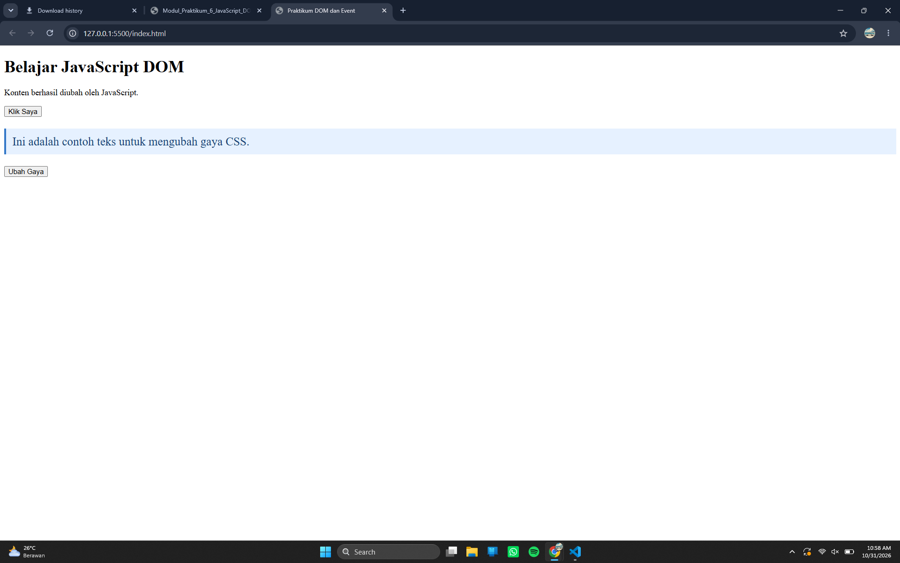
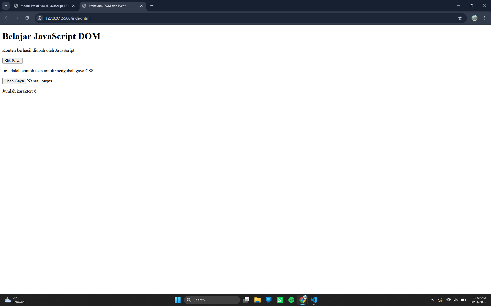
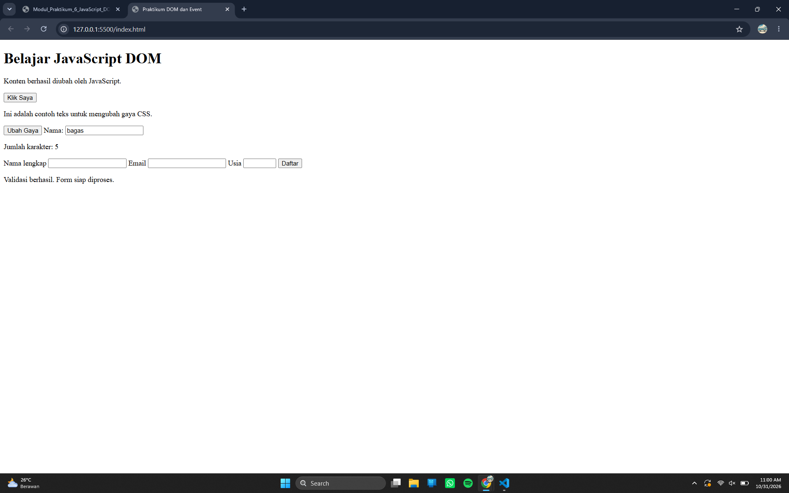
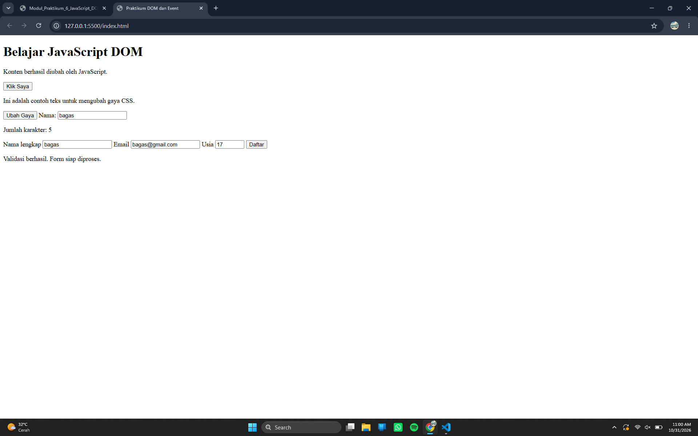
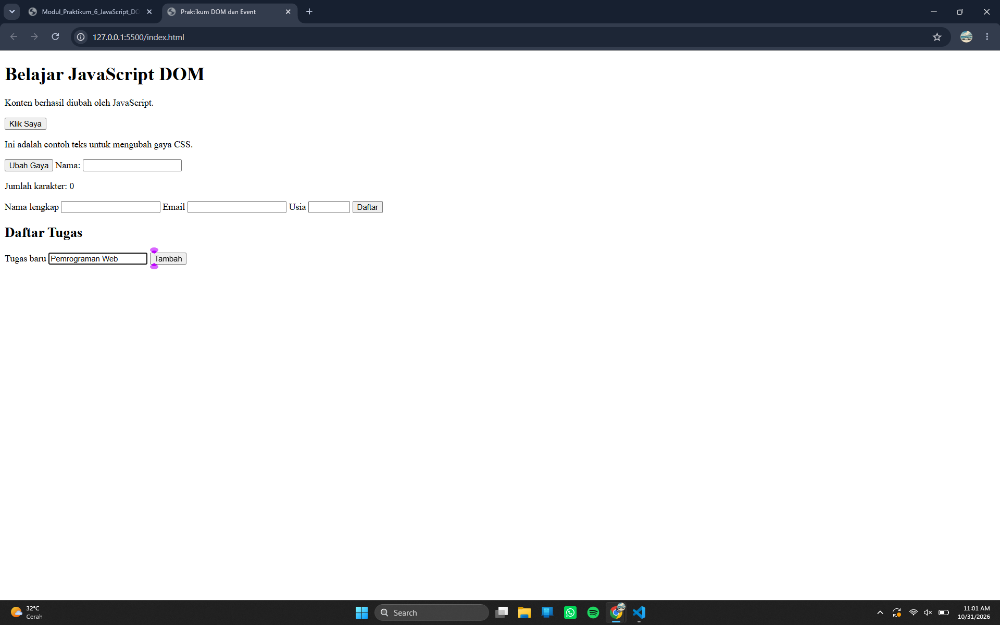
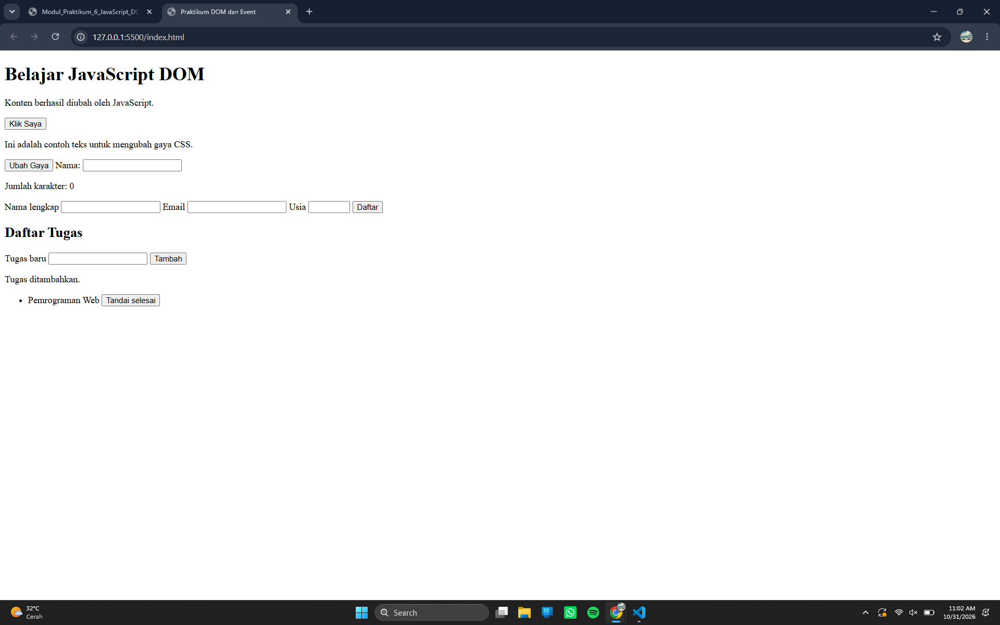


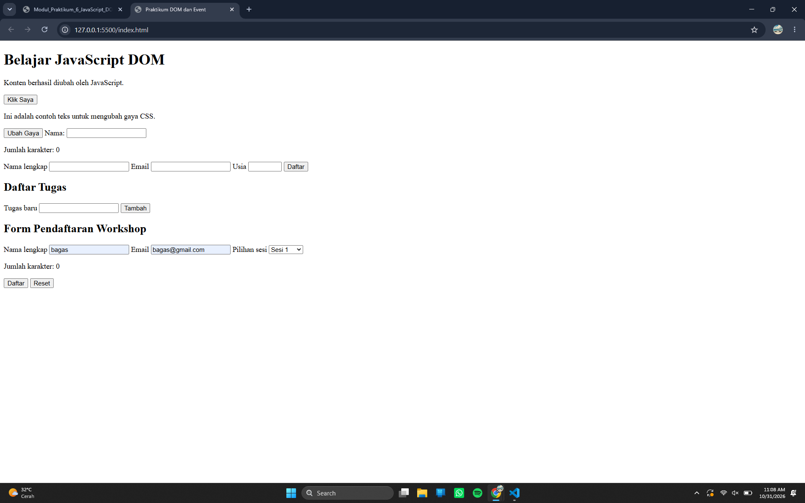
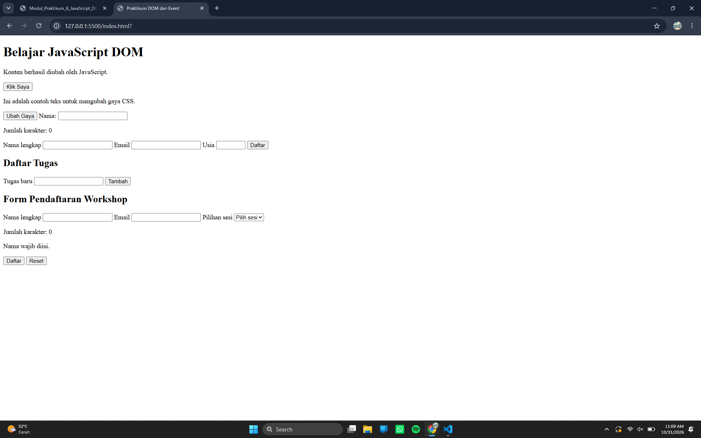
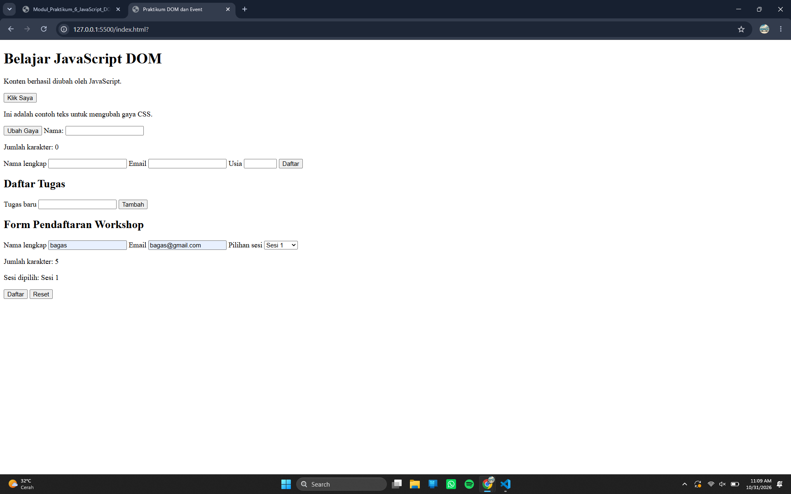

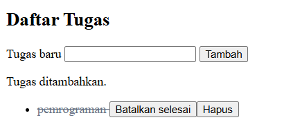
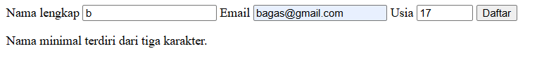
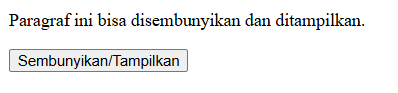
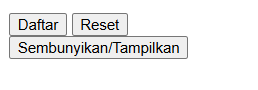


